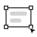
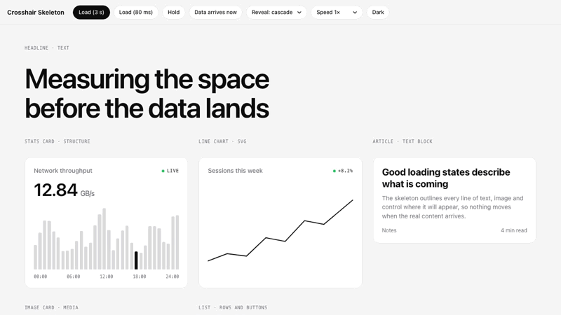
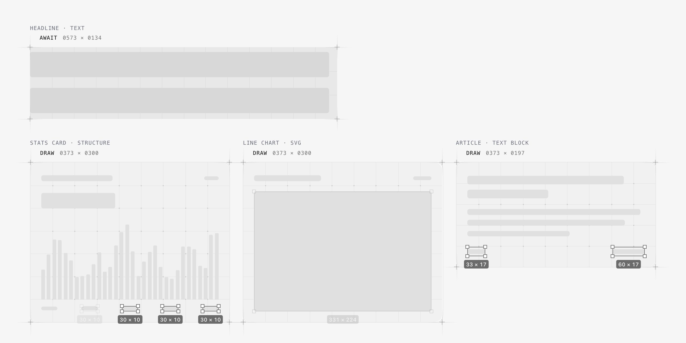
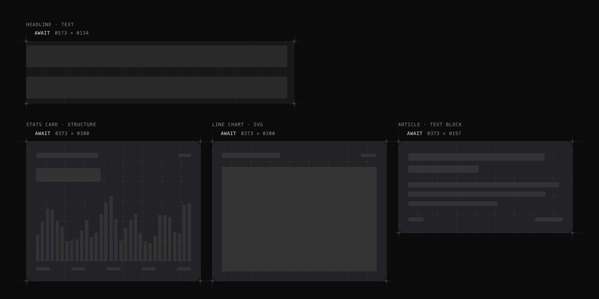

<p align="center">
  <a href="https://library.veloxthemes.com/?utm_source=github&utm_medium=readme&utm_campaign=crosshair-skeleton">
    <picture>
      <source media="(prefers-color-scheme: dark)" srcset="media/logo-dark.svg">
      
    </picture>
  </a>
</p>

<h1 align="center">Crosshair Skeleton</h1>

<p align="center">
  An animated skeleton loader that draws a loading skeleton in your real layout.<br>
  React, Next.js, Vue, Svelte or plain JS. Light and dark, no dependencies.
</p>

<p align="center">
  <a href="#try-it-locally">Demo</a> ·
  <a href="#usage">Usage</a> ·
  <a href="./AGENT-GUIDE.md">Agent guide</a> ·
  <a href="https://library.veloxthemes.com/?utm_source=github&utm_medium=readme&utm_campaign=crosshair-skeleton">Made by Velox Themes</a>
</p>

<p align="center">
  <a href="./LICENSE"></a>
  <a href="#install"></a>
  <a href="#performance"></a>
  <a href="#react-nextjs-vue-and-svelte"></a>
  <a href="#as-an-agent-skill"></a>
</p>

<p align="center">
  <picture>
    <source media="(prefers-color-scheme: dark)" srcset="media/preview-dark.gif">
    
  </picture>
</p>

Crosshair Skeleton is a skeleton loader (a skeleton screen) and an attention effect: use it to highlight one supporting element on a landing page, or as the loading state of a block that waits on data. Crosshair corners lock onto the element, a grid maps it, and cursors select every element inside, size labels and all, leaving a skeleton block in its exact shape. When the data lands, the real content swaps in element by element: no shimmer, no layout jump. This repository is the whole thing: one dependency-free ES module, adapters for React and Next.js, Vue and Svelte, and an agent skill for Claude Code and Codex.

<br>

## Features

- **A landing-page highlight.** With `auto`, it plays once when a hero visual, an image or a bento card scrolls into view, then shows the content after a short pause. No data needed.
- **Draws your real layout.** It reads what is inside the element: one bar per line of text at its real width, and buttons, chips, images, charts and inputs as blocks in their own shape and corner radius. When the data arrives it measures again, so the swap always lands on the real layout.
- **Tables, lists and charts in one go.** Table rows, list items, cards of one kind and chart bars are drawn as groups, all at once rather than one by one.
- **Any element, any framework.** Cards, charts, tables, forms, text, images, lists, video and code, in plain JavaScript, React, Next.js, Vue, Nuxt, Svelte, SvelteKit, Solid, Angular, Lit, Astro, Alpine or htmx. No CSS file, fonts or images to add.
- **Light and dark.** Every colour comes from the element's own text colour and the background behind it, so it matches your theme with no setup and follows a theme switch while it waits.
- **Light on the CPU, big pages included.** The long wait runs on the compositor with no JavaScript, off-screen skeletons don't build until they scroll in, and only what is on screen is animated: a skeleton over 3,000 rows hands over in one short task.
- **Never in the way.** Loads under 150 ms show nothing, a shown skeleton never flashes, the placeholder is `inert` and `aria-busy` while loading, reduced motion gets a static skeleton, and nothing is left in the DOM afterwards.
- **An agent skill.** Drop the folder into Claude Code or Codex and ask for "a crosshair loading skeleton on the revenue card". [AGENT-GUIDE.md](./AGENT-GUIDE.md) gives agents the procedure, the pitfalls and a browser checklist.

| Drawing: cursors select each element | Waiting, in dark mode |
| --- | --- |
|  |  |

<br>

## When to use it

It is a cosmetic effect that draws the eye, so restraint is the point:

- **Highlight one supporting element per section:** the hero visual, an image container, the bento card you want noticed. Not the headline, copy, buttons or navigation.
- **At most one per section and three per page.** Most pages need one.
- **Skip busy sections** (long lists, pricing tables, logo walls): when a block looks crowded, the effect only adds noise.
- **Keep the hero's largest element visible,** so the page load Google measures is not delayed.
- **In an app,** use it as the loading state of one slow block of data, not on every card or widget.

The full rules, with what to use instead, are in [SKILL.md](./SKILL.md#when-to-use-it-and-when-not).

<br>

## Install

```bash
npm install crosshair-skeleton
```

Or copy [`crosshair-skeleton.js`](./crosshair-skeleton.js) into your project. It is one file.

### As an agent skill

Copy this folder into your agent's skills directory:

| Agent | Folder |
|---|---|
| Claude Code | `~/.claude/skills/crosshair-skeleton/` (or `.claude/skills/` in a project) |
| Codex | `~/.codex/skills/crosshair-skeleton/` |
| Others that read `SKILL.md` | Their skills folder |

Agents applying the skill should follow [AGENT-GUIDE.md](./AGENT-GUIDE.md): the integration procedure, pitfalls seen on production UI, and a browser verification checklist.

<br>

## Usage

```js
import { crosshair } from "crosshair-skeleton";

const card = document.querySelector("#revenue");
const skeleton = crosshair(card);        // loading starts
renderRevenue(card, await getRevenue()); // real content in place, still hidden
await skeleton.done();                   // revealed, overlay removed
```

Declarative, for any framework or server-rendered HTML:

```html
<section data-crosshair="loading" data-crosshair-reveal="flow">…</section>
<script type="module">
  import { watch } from "./crosshair-skeleton.js"; // or "crosshair-skeleton" with a bundler
  watch(); // set data-crosshair to anything else to reveal
</script>
```

### React, Next.js, Vue and Svelte

```jsx
// React, Next.js, Remix, Preact
import { useCrosshair } from "crosshair-skeleton/react";
const ref = useCrosshair(!data);           // <div ref={ref}>…</div>
```

```html
<!-- Vue, Nuxt: app.use(CrosshairSkeleton) from "crosshair-skeleton/vue" -->
<div v-crosshair="!data">…</div>

<!-- Svelte, SvelteKit: import { skeleton } from "crosshair-skeleton/svelte" -->
<div use:skeleton={!data}>…</div>
```

Each adapter is tested against the real framework: the skeleton appears, the real data is revealed, a reload restarts it and an unmount mid-load leaves nothing behind. Tested: React 19 (Strict Mode), Preact 10, Vue 3.5, Svelte 5, Solid 1.9, Lit 3 (shadow DOM), Alpine 3 and htmx 2. React and Vue also server-render cleanly (Next.js, Nuxt). Solid, Angular, Lit, Astro, Alpine and htmx patterns, every option, part hints and theming are in [SKILL.md](./SKILL.md).

<br>

## Options

| Option | Default | |
|---|---|---|
| `reveal` | `"cascade"` | `"cascade"` (element by element), `"flow"` (strictly top to bottom) or `"fade"` (all at once) |
| `grace` | `150` | Loads faster than this (ms) never show a skeleton |
| `minVisible` | `600` | Once shown, it stays at least this long (ms) |
| `trace` | `"auto"` | `"auto"` draws every element inside, `"box"` only the element's own selection, `"none"` grid and corners only |
| `cursors` | `true` | `true` (1 to 3, by element count), `false`, or a number from 1 to 4 |
| `labels` | `true` | `W × H` size labels under each selection |
| `speed` | `1` | `2` is twice as fast |
| `auto` | `false` | `true` for a landing-page highlight: plays once when the element scrolls into view, then shows the content by itself |

<br>

## How it knows the shape

It draws whatever is inside the element when loading starts. Render your real component with placeholder data at its final size and you get its exact structure: one bar per line of text at its real width, and buttons, chips, images, charts and inputs as blocks in their own shape and corner radius. Table rows, list items and chart bars are drawn as groups, all at once rather than one by one. When the data arrives it measures again, so the swap always lands on the real layout. An empty container falls back to its own selection, grid and corners. `data-crosshair-part="skip | box"` overrides any part.

<br>

## Performance

Measured with `bench.html` at 375, 768 and 1440 px, with every demo skeleton in the viewport (5 to 9) building at once:

| | Build and draw (about 3 s) | Waiting |
|---|---|---|
| Chrome 153 | 0 long frames, render work p95 under 3.5 ms | about 0.4 to 0.6 ms per frame |
| Firefox 159 | 0 long frames, render work p95 under 9 ms | under 0.1 ms per frame |
| WebKit 26.6 (Safari) | 1 long frame, render work p95 under 4 ms | about 0.6 to 0.8 ms per frame |

On data-heavy pages (Chrome, 4× CPU throttling): 24 dashboard cards plus a 300-row list build at a steady 60 fps (p95 16.8 ms) with no long tasks, and a skeleton over a 3,000-row list hands over with one 67 ms task, where the first version froze for 3.7 s.

Skeletons that start together cascade in 60 ms apart, `prefers-reduced-motion` gets a static skeleton and a short fade, and nothing is left in the DOM after the reveal.

<br>

## Try it locally

```bash
npx serve .
```

Then open `demo.html` (21 examples with slow, fast and held loads, all three reveals and both themes) or `bench.html`. Opening the files directly from disk does not work: browsers block ES modules on `file://`.

<br>

## Made by Velox Themes

Crosshair Skeleton is free and open source, made by **[Velox Themes](https://library.veloxthemes.com/?utm_source=github&utm_medium=readme&utm_campaign=crosshair-skeleton)**. If you build websites for clients, Velox Themes also has polished sections, components and templates you can copy straight into your project.

<br>

## License

[MIT](./LICENSE)
