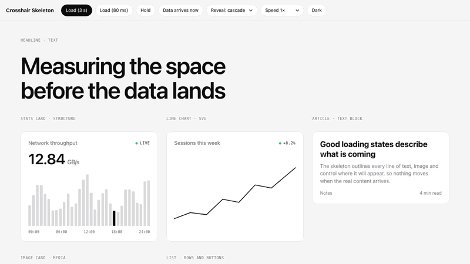

# Crosshair Skeleton

**A loading skeleton that measures your UI before it arrives.** Crosshair corners lock onto the element, a grid maps it, the shape of what is inside is traced line by line, and when the data lands the real content takes its place: no shimmer, no layout jump.

<a href="media/crosshair-skeleton.mp4">
  <picture>
    <source media="(prefers-color-scheme: dark)" srcset="media/demo-dark.gif">
    
  </picture>
</a>

▶ **[Watch the full demo](media/crosshair-skeleton.mp4)**: fade, blink and scan reveals, in light and dark (35 s).

- **Any element:** cards, charts, tables, forms, text, images, lists, video, code. It reads what is inside and traces it.
- **Any framework:** plain JavaScript, React, Next.js, Vue, Svelte, Astro, Angular. One ES module, no dependencies, no CSS file, no fonts, no images.
- **Light and dark:** every colour comes from the element's own text colour, so it matches your theme with no setup.
- **Cheap to run:** the long wait runs on the compositor, off-screen skeletons wait to build, and everything is removed after the reveal.
- **Agent skill included:** drop it into Claude Code or Codex and ask for "a crosshair loading skeleton on the revenue card".

## Install

```bash
npm install crosshair-skeleton
```

Or copy [`crosshair-skeleton.js`](./crosshair-skeleton.js) into your project. It is one file.

### As an agent skill

Copy this folder into your agent's skills directory:

| Agent | Folder |
|---|---|
| Claude Code | `~/.claude/skills/crosshair-skeleton/` (or `.claude/skills/` in a project) |
| Codex | `~/.codex/skills/crosshair-skeleton/` |
| Others that read `SKILL.md` | Their skills folder |

## Usage

```js
import { crosshair } from "crosshair-skeleton";

const card = document.querySelector("#revenue");
const skeleton = crosshair(card);        // loading starts
renderRevenue(card, await getRevenue()); // real content in place, still hidden
await skeleton.done();                   // revealed, overlay removed
```

Declarative, for any framework or server-rendered HTML:

```html
<section data-crosshair="loading" data-crosshair-reveal="blink">…</section>
<script type="module">
  import { watch } from "crosshair-skeleton";
  watch(); // set data-crosshair to anything else to reveal
</script>
```

React, Vue and Svelte examples, every option, part hints and theming are in [SKILL.md](./SKILL.md).

## Options

| Option | Default | |
|---|---|---|
| `reveal` | `"fade"` | `"fade"`, `"blink"` (sections flicker on in order) or `"scan"` (a dithered line wipes down) |
| `grace` | `150` | Loads faster than this (ms) never show a skeleton |
| `minVisible` | `600` | Once shown, it stays at least this long (ms) |
| `trace` | `"auto"` | `"auto"` traces what is inside, `"box"` the outer box, `"none"` grid and corners only |
| `speed` | `1` | `2` is twice as fast |

## How it knows the shape

It traces whatever is inside the element when loading starts. Render your real component with placeholder data at its final size and you get its exact structure: text lines at their real widths, images as a box with a cross, charts as a box with guides, buttons and inputs as boxes. An empty container falls back to its outer box, grid and corners. `data-crosshair-part="skip | box | chart | media"` overrides any part.

## Performance

Measured with `bench.html`, all 21 demo skeletons on screen at once:

| | Build (about 1.5 s) | Waiting |
|---|---|---|
| Chrome 152 | 60 fps, render work p95 under 3 ms | about 0.3 ms per frame |
| Firefox 158 | 60 fps, at most 2 long frames, render work p95 under 9 ms | under 0.1 ms per frame |
| WebKit 26.6 (Safari) | 60 fps, a few long frames | about 1.4 ms per frame |

Skeletons that start together cascade in 60 ms apart, `prefers-reduced-motion` gets a static skeleton and a short fade, and nothing is left in the DOM after the reveal.

## Try it locally

```bash
npx serve .
```

Then open `demo.html` (21 examples with slow, fast and held loads, all three reveals and both themes) or `bench.html`. Opening the files directly from disk does not work: browsers block ES modules on `file://`.

## Made by Velox Themes

Crosshair Skeleton is free and open source, made by **[Velox Themes](https://library.veloxthemes.com/?utm_source=github&utm_medium=readme&utm_campaign=crosshair-skeleton)**. If you build websites for clients, **[Velox Library](https://library.veloxthemes.com/?utm_source=github&utm_medium=readme&utm_campaign=crosshair-skeleton)** has polished sections, components and templates you can copy straight into your project.

## License

[MIT](./LICENSE)
